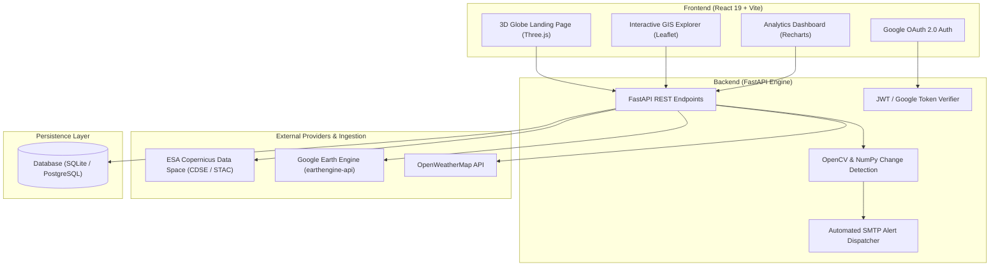

# GeoAlert 🛰️
### Real-Time Geospatial Intelligence, Earth Observation & Automated Environmental Alerting

[](https://fastapi.tiangolo.com)
[](https://www.python.org)
[](https://react.dev)
[](https://vitejs.dev)
[](https://threejs.org)
[](https://leafletjs.com)
[](https://tailwindcss.com)
[](https://earthengine.google.com)
[](LICENSE)

---

## 🔭 Overview

**GeoAlert** is an end-to-end planetary observation and geospatial intelligence platform designed for monitoring land-use transformations, vegetation degradation, deforestation, and urban encroachment.

By coupling high-resolution multispectral imagery from **ESA Copernicus Sentinel-2** and **Google Earth Engine** with computer vision algorithms (**OpenCV & NumPy**), GeoAlert detects surface anomalies in near real-time, calculates Normalized Difference Vegetation Index (**NDVI**) fluctuations, and automatically triggers email alerts to stakeholders when critical environmental thresholds are breached.

---

## ✨ Key Capabilities

- **🛰️ Multi-Provider Earth Observation**: Ingests Sentinel-2 L2A multispectral data (Band 4 Red & Band 8 NIR at 10m spatial resolution) via ESA Copernicus Data Space STAC APIs and Google Earth Engine planetary catalogs.
- **🌿 Precision NDVI & Spectral Processing**: Computes per-pixel NDVI across temporal timestamps ($T_1$ and $T_2$) to assess vegetation health, canopy loss, and soil exposure.
- **🔬 Computer Vision Change Detection**: Utilizes OpenCV image differencing, morphological noise reduction (opening/closing kernels), and connected-component analysis to highlight genuine land alterations.
- **🌐 3D Planetary Visualization & Interactive GIS**: Features an interactive 3D Earth Globe built with **Three.js** / **React Three Fiber** alongside a high-performance **Leaflet** GIS explorer with custom Area of Interest (AOI) polygon, rectangle, and marker drawing.
- **🏙️ Specialized Analytical Pipelines**:
  - **Urban Expansion**: Google Earth Engine integration for tracking impervious surfaces and built-up land growth.
  - **Agricultural Monitoring**: Time-series NDVI profiling for crop vigor and stress detection.
- **📧 Automated Alert Engine**: Configurable anomaly thresholds with instant, automated SMTP HTML email dispatch delivering change metrics and spatial summaries.
- **🌦️ Environmental & Weather Telemetry**: Integrated OpenWeatherMap overlay displaying real-time local temperature, humidity, and cloud coverage for active AOIs.
- **🔐 Multi-Tenant & Secure**: Google OAuth 2.0 verification, user-isolated AOIs and alerts, backed by SQLAlchemy with SQLite (development) and PostgreSQL (production) compatibility.

---

## 🏗️ Architecture



---

## 🗂️ Project Structure

```
GeoAlert/
├── backend/                  # FastAPI Application
│   ├── main.py               # Core FastAPI routes, CV engine & GEE services
│   ├── requirements.txt      # Python dependencies
│   ├── .env.example          # Environment variables template
│   ├── test_api.py           # Backend test suite
│   ├── test_ee.py            # Earth Engine verification script
│   └── test_db_isolation.py  # Multi-tenant isolation tests
├── frontend/                 # React 19 + Vite Application
│   ├── src/
│   │   ├── components/       # Reusable components (AOIMap, Charts, Sidebar, Topbar)
│   │   ├── pages/            # Views (Dashboard, MapExplorer, Analysis, Alerts, Settings)
│   │   ├── context/          # Global application state & Auth providers
│   │   └── index.css         # Tailwind & modern design tokens
│   ├── package.json          # Node dependencies & build scripts
│   └── vite.config.js        # Vite bundling configuration
├── .gitignore                # Git ignore rules (protects credentials & cache)
└── README.md                 # Project documentation
```

---

## 🚀 Quick Start

### Prerequisites

- **Python**: 3.10 or 3.11+
- **Node.js**: 18.x or 20.x+
- **npm**: 9.x+

---

### 1. Backend Setup

1. **Navigate to backend and create a virtual environment:**
   ```bash
   cd backend
   python -m venv .venv
   ```

2. **Activate the virtual environment:**
   - **Windows (PowerShell):**
     ```powershell
     .venv\Scripts\Activate.ps1
     ```
   - **Linux / macOS:**
     ```bash
     source .venv/bin/activate
     ```

3. **Install dependencies:**
   ```bash
   pip install -r requirements.txt
   ```

4. **Configure environment variables:**
   ```bash
   cp .env.example .env
   ```
   *Edit `.env` to configure satellite APIs, Google Earth Engine, or SMTP email credentials (see [Environment Configuration](#-environment-configuration)).*

5. **Start the FastAPI server:**
   ```bash
   uvicorn main:app --reload --port 8000
   ```
   The backend will be available at: **http://127.0.0.1:8000**  
   Interactive Swagger docs: **http://127.0.0.1:8000/docs**

---

### 2. Frontend Setup

1. **Navigate to the frontend directory:**
   ```bash
   cd frontend
   ```

2. **Install Node packages:**
   ```bash
   npm install
   ```

3. **Start the Vite development server:**
   ```bash
   npm run dev
   ```
   Open your browser at: **http://localhost:5173**

---

## ⚙️ Environment Configuration

Configuration variables are managed in `backend/.env`. Refer to [`backend/.env.example`](backend/.env.example) for the default template:

| Variable | Description | Default / Example | Required |
|---|---|---|:---:|
| `CDSE_CLIENT_ID` | ESA Copernicus Data Space OAuth Client ID | `your_cdse_client_id` | Optional* |
| `CDSE_CLIENT_SECRET` | ESA Copernicus Data Space OAuth Secret | `your_cdse_client_secret` | Optional* |
| `EE_SERVICE_ACCOUNT_KEY` | Google Earth Engine Service Account credentials (JSON or file path) | `backend/earth_engine_key.json` | Optional* |
| `OPENWEATHER_API_KEY` | OpenWeatherMap API Key for atmospheric telemetry | `your_openweather_key` | Optional |
| `DATABASE_URL` | SQLAlchemy connection string | `sqlite:///./database.db` | No |
| `GOOGLE_CLIENT_ID` | Google OAuth Client ID for frontend token validation | `your_google_client_id` | No |
| `SMTP_HOST` | Outgoing SMTP mail server | `smtp.gmail.com` | No |
| `SMTP_PORT` | Outgoing SMTP port | `587` | No |
| `SMTP_USER` | SMTP sender email address | `user@example.com` | For Alerts |
| `SMTP_PASS` | SMTP application password | `app_password` | For Alerts |
| `ALERT_RECIPIENT` | Fallback alert destination email | `admin@example.com` | No |

*\* Note: When CDSE or GEE credentials are omitted, the backend gracefully utilizes public STAC search fallbacks and synthetic test scenes for offline development.*

---

## 🔬 Change Detection & NDVI Methodology

### Normalized Difference Vegetation Index (NDVI)

$$\text{NDVI} = \frac{\text{NIR} - \text{RED}}{\text{NIR} + \text{RED}} = \frac{\text{Band 8} - \text{Band 4}}{\text{Band 8} + \text{Band 4}}$$

| NDVI Range | Surface Classification | Alert Significance |
|:---|:---|:---|
| **0.70 to 1.00** | Dense, healthy forest canopy or active crops | Baseline optimal |
| **0.50 to 0.69** | Moderate vegetation / shrubland | Normal |
| **0.20 to 0.49** | Sparse vegetation, degraded cropland | Potential stress |
| **0.00 to 0.19** | Bare soil, rock, urban surface | Deforested / Cleared |
| **< 0.00** | Open water, wetlands, cloud shadows | Hydrological variation |

### Temporal Differencing Pipeline

1. **Acquisition**: Query Sentinel-2 L2A STAC items for baseline timestamp ($T_1$) and target timestamp ($T_2$) covering the AOI bounding box.
2. **Spectral Computation**: Derive per-pixel NDVI matrices for both periods: $\text{NDVI}_{T_1}$ and $\text{NDVI}_{T_2}$.
3. **Differencing**: Calculate the delta map: $\Delta \text{NDVI} = \text{NDVI}_{T_2} - \text{NDVI}_{T_1}$.
4. **Threshold Segmentation**: Flag pixels exceeding the threshold ($\Delta \text{NDVI} \le -\tau$, default $\tau = 0.10$) as negative anomalies.
5. **Morphological Cleaning**: Apply OpenCV morphological opening and closing kernels to filter out single-pixel sensor noise and atmospheric artifacts.
6. **Classification & Action**:
   - **Critical** ($\text{Change} \ge 15\%$): Immediate automated SMTP alert dispatched.
   - **Warning** ($5\% \le \text{Change} < 15\%$): Recorded in user alerts panel.
   - **Info** ($\text{Change} < 5\%$): Logged for baseline trend tracking.

---

## 📡 API Reference Summary

| Method | Endpoint | Description |
|---|---|---|
| `GET` | `/health` | Healthcheck and provider status |
| `POST` | `/users` | Register or authenticate a user via Google OAuth |
| `GET` | `/aois` | Fetch active Areas of Interest for the authenticated user |
| `POST` | `/aois` | Create a new AOI and trigger initial baseline scan |
| `PUT` | `/aois/{id}` | Update AOI boundaries, alert thresholds, or name |
| `DELETE` | `/aois/{id}` | Remove an AOI from tracking |
| `GET` | `/alerts` | Retrieve user alert history |
| `POST` | `/analysis/detect` | Execute temporal change detection on an AOI |
| `POST` | `/alerts/{id}/email` | Dispatch alert notification email for a specific incident |
| `POST` | `/api/v1/ee/urban` | Google Earth Engine urban expansion analysis |
| `POST` | `/api/v1/agro/ndvi` | Google Earth Engine agricultural time series |

---

## 🛡️ Security & Privacy

- **Zero-Credential Commits**: All private keys, `.env` files, database files, and service account tokens (`earth_engine_key.json`) are strictly ignored via `.gitignore` and kept out of version control.
- **Tenant Isolation**: Every AOI and alert entry is scoped to the verified user's identity.

---

## 🤝 Contributing

Contributions are welcome! To get started:
1. Fork the repository on GitHub.
2. Create a feature branch: `git checkout -b feature/amazing-feature`.
3. Commit your changes: `git commit -m "Add amazing feature"`.
4. Push to the branch: `git push origin feature/amazing-feature`.
5. Open a Pull Request.

---

## 📄 License

This project is licensed under the **MIT License**. See the `LICENSE` file for details.

---

<p align="center">
  <b>GeoAlert</b> — <i>Planetary Perspective for Local Action</i> 🌍
</p>
