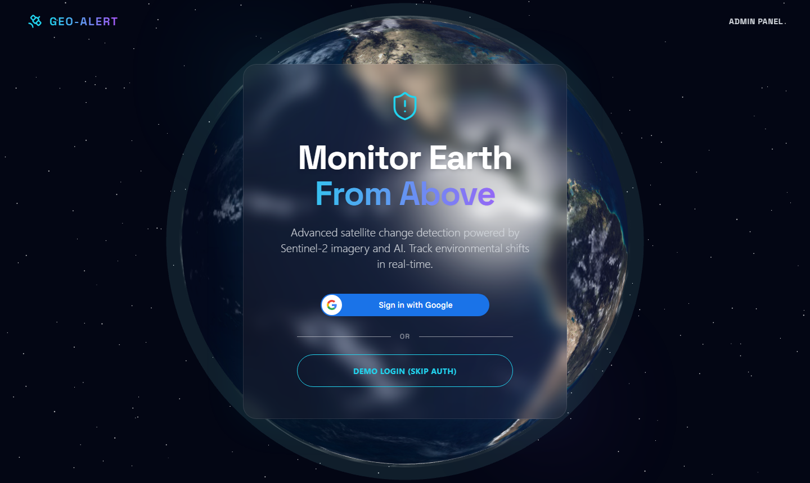
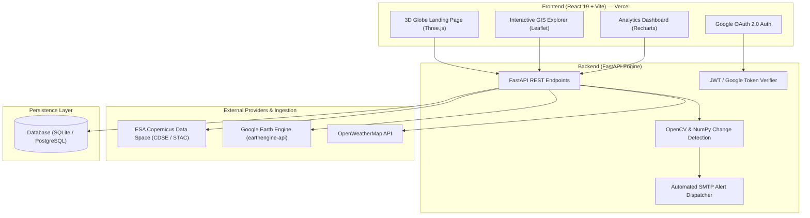

# GeoAlert 🛰️

<div align="center">

### Real-Time Geospatial Intelligence, Earth Observation & Automated Environmental Alerting

[](https://geo-alert-ten.vercel.app/)
[](https://github.com/yogesh-patil2003/GeoAlert)
[](LICENSE)

---

[](https://fastapi.tiangolo.com)
[](https://www.python.org)
[](https://react.dev)
[](https://vitejs.dev)
[](https://threejs.org)
[](https://leafletjs.com)
[](https://tailwindcss.com)
[](https://earthengine.google.com)

</div>

---

## 🚀 Live Demo

> **Try it live:** [https://geo-alert-ten.vercel.app/](https://geo-alert-ten.vercel.app/)

The frontend is deployed on **Vercel** and connects to a **FastAPI** backend for real-time earth observation, NDVI analysis, and change detection.

---

## 🔭 Overview

**GeoAlert** is an end-to-end planetary observation and geospatial intelligence platform designed for monitoring land-use transformations, vegetation degradation, deforestation, and urban encroachment.

By coupling high-resolution multispectral imagery from **ESA Copernicus Sentinel-2** and **Google Earth Engine** with computer vision algorithms (**OpenCV & NumPy**), GeoAlert detects surface anomalies in near real-time, calculates Normalized Difference Vegetation Index (**NDVI**) fluctuations, and automatically triggers email alerts to stakeholders when critical environmental thresholds are breached.

---

## ✨ Key Capabilities

| Feature | Description |
|---|---|
| 🛰️ **Multi-Provider EO** | Ingests Sentinel-2 L2A multispectral data (Band 4 Red & Band 8 NIR at 10m) via ESA Copernicus STAC APIs and Google Earth Engine |
| 🌿 **Precision NDVI** | Computes per-pixel NDVI across temporal timestamps (T₁ and T₂) to assess vegetation health, canopy loss, and soil exposure |
| 🔬 **CV Change Detection** | Utilizes OpenCV image differencing, morphological noise reduction (opening/closing kernels), and connected-component analysis |
| 🌐 **3D Globe + GIS** | Interactive 3D Earth Globe (Three.js / React Three Fiber) + Leaflet GIS explorer with custom AOI polygon, rectangle & marker drawing |
| 🏙️ **Urban Expansion** | Google Earth Engine integration for tracking impervious surfaces and built-up land growth |
| 🌾 **Agricultural Monitoring** | Time-series NDVI profiling for crop vigor and stress detection |
| 📧 **Automated Alerts** | Configurable anomaly thresholds with instant SMTP HTML email dispatch delivering change metrics and spatial summaries |
| 🌦️ **Weather Telemetry** | Integrated OpenWeatherMap overlay showing real-time temperature, humidity, and cloud coverage for active AOIs |
| 🔐 **Secure Multi-Tenant** | Google OAuth 2.0 verification, user-isolated AOIs and alerts, backed by SQLAlchemy with SQLite/PostgreSQL |

---

## 🖼️ Screenshots



> Visit the live app at [https://geo-alert-ten.vercel.app/](https://geo-alert-ten.vercel.app/) to see GeoAlert in action.

---

## 🏗️ Architecture



---

## 🗂️ Project Structure

```
GeoAlert/
├── backend/                      # FastAPI Application
│   ├── main.py                   # Core FastAPI routes, CV engine & GEE services
│   ├── requirements.txt          # Python dependencies
│   ├── .env.example              # Environment variables template
│   ├── test_api.py               # Backend test suite
│   ├── test_ee.py                # Earth Engine verification script
│   └── test_db_isolation.py     # Multi-tenant isolation tests
├── frontend/                     # React + Vite Application
│   ├── src/                      # React source code
│   ├── public/                   # Static assets
│   ├── index.html                # Entry HTML
│   ├── package.json              # JS dependencies
│   ├── vite.config.js            # Vite bundler config
│   ├── tailwind.config.js        # Tailwind CSS config
│   └── postcss.config.js         # PostCSS config
├── stac_clean.json               # Sample STAC metadata (clean)
├── stac_out.json                 # Sample STAC metadata (raw)
├── LICENSE                       # MIT License
└── README.md
```

---

## 🛠️ Tech Stack

### Frontend

| Technology | Version | Purpose |
|---|---|---|
| [React](https://react.dev) | 19.2 | UI framework |
| [Vite](https://vitejs.dev) | 7.3 | Build tool & dev server |
| [Three.js](https://threejs.org) / [@react-three/fiber](https://r3f.docs.pmnd.rs) | r183 / 9.5 | 3D Earth Globe rendering |
| [@react-three/drei](https://github.com/pmndrs/drei) | 10.7 | Three.js helpers |
| [Leaflet](https://leafletjs.com) + [React-Leaflet](https://react-leaflet.js.org) | 1.9 | 2D GIS map & AOI drawing |
| [TailwindCSS](https://tailwindcss.com) | 3.4 | Utility-first styling |
| [Framer Motion](https://www.framer.com/motion/) | 12.x | UI animations |
| [Recharts](https://recharts.org) | — | Analytics charts |
| [Axios](https://axios-http.com) | 1.13 | HTTP client |
| [date-fns](https://date-fns.org) | 4.x | Date utilities |

### Backend

| Technology | Version | Purpose |
|---|---|---|
| [FastAPI](https://fastapi.tiangolo.com) | 0.115 | REST API framework |
| [Uvicorn](https://www.uvicorn.org) | 0.32 | ASGI server |
| [OpenCV (headless)](https://opencv.org) | 4.10 | Computer vision & change detection |
| [NumPy](https://numpy.org) | 1.26 | Numerical & spectral computation |
| [Pillow](https://pillow.readthedocs.io) | 10.4 | Image processing |
| [SQLAlchemy](https://www.sqlalchemy.org) | 2.0 | ORM & database layer |
| [Pydantic](https://docs.pydantic.dev) | 2.8 | Data validation |
| [httpx](https://www.python-httpx.org) | 0.27 | Async HTTP client |
| [python-dotenv](https://pypi.org/project/python-dotenv) | 1.0 | Environment variable management |
| [earthengine-api](https://developers.google.com/earth-engine) | latest | Google Earth Engine planetary catalog |
| [python-multipart](https://pypi.org/project/python-multipart) | 0.0.9 | Form/file upload support |

### Infrastructure & APIs

- **Deployment**: [Vercel](https://vercel.com) (Frontend) + any ASGI host (Backend)
- **Satellite Data**: [ESA Copernicus Data Space (CDSE)](https://dataspace.copernicus.eu) — Sentinel-2 L2A via STAC API
- **Planetary Compute**: [Google Earth Engine](https://earthengine.google.com)
- **Weather**: [OpenWeatherMap API](https://openweathermap.org/api)
- **Authentication**: [Google OAuth 2.0](https://developers.google.com/identity)
- **Database**: SQLite (development) / PostgreSQL (production)

---

## ⚙️ Local Setup

### Prerequisites

- Python 3.11+
- Node.js 18+
- A Google Cloud project with Earth Engine API enabled
- ESA Copernicus Data Space account (free)
- OpenWeatherMap API key (free tier)
- Gmail / SMTP credentials for alert emails

---

### 1. Clone the Repository

```bash
git clone https://github.com/yogesh-patil2003/GeoAlert.git
cd GeoAlert
```

---

### 2. Backend Setup

```bash
cd backend

# Create virtual environment
python -m venv venv

# Activate (Linux/macOS)
source venv/bin/activate

# Activate (Windows)
venv\Scripts\activate

# Install dependencies
pip install -r requirements.txt
```

#### Configure Environment Variables

Copy `.env.example` to `.env` and fill in your credentials:

```bash
cp .env.example .env
```

Key environment variables:

```env
# Google Earth Engine
EE_SERVICE_ACCOUNT_KEY=your-service-account-json-or-base64

# Copernicus Data Space
CDSE_CLIENT_ID=your-cdse-client-id
CDSE_CLIENT_SECRET=your-cdse-client-secret

# OpenWeatherMap
OPENWEATHER_API_KEY=your-openweathermap-key

# Email Alerts (SMTP)
SMTP_HOST=smtp.gmail.com
SMTP_PORT=587
SMTP_USER=your@gmail.com
SMTP_PASS=your-app-password
ALERT_RECIPIENT=alerts_recipient@example.com

# Google OAuth
GOOGLE_CLIENT_ID=your-google-client-id

# Database
DATABASE_URL=sqlite:///./database.db
```

#### Run the Backend Server

```bash
uvicorn main:app --host 0.0.0.0 --port 8000 --reload
```

API docs available at: [http://localhost:8000/docs](http://localhost:8000/docs)

---

### 3. Frontend Setup

```bash
cd ../frontend

# Install dependencies
npm install

# Start development server
npm run dev
```

App available at: [http://localhost:5173](http://localhost:5173)

#### Frontend Build (Production)

```bash
npm run build
```

---

### 4. Running Tests

```bash
cd backend

# Backend API tests
python test_api.py

# Earth Engine connectivity test
python test_ee.py

# Multi-tenant DB isolation tests
python test_db_isolation.py
```

---

## 🌍 How It Works

```
┌─────────────────────────────────────────────────────────┐
│                   User draws AOI on map                 │
│           (polygon / rectangle / marker)                │
└────────────────────────────┬────────────────────────────┘
                             │
                             ▼
┌─────────────────────────────────────────────────────────┐
│          FastAPI fetches Sentinel-2 imagery             │
│      from ESA Copernicus STAC (T₁ and T₂ dates)        │
└────────────────────────────┬────────────────────────────┘
                             │
                             ▼
┌─────────────────────────────────────────────────────────┐
│   OpenCV + NumPy compute NDVI per-pixel difference      │
│   Morphological filtering removes sensor noise          │
│   Connected-component analysis isolates real changes    │
└────────────────────────────┬────────────────────────────┘
                             │
                  ┌──────────┴──────────┐
                  ▼                     ▼
     ┌────────────────────┐  ┌──────────────────────┐
     │  Results returned  │  │  Threshold breached?  │
     │  to React frontend │  │  → Email alert sent   │
     │  (map overlay +    │  │  via SMTP dispatcher  │
     │   NDVI chart)      │  └──────────────────────┘
     └────────────────────┘
```

---

## 📊 NDVI Formula

$$
NDVI = \frac{NIR - Red}{NIR + Red} = \frac{Band_8 - Band_4}{Band_8 + Band_4}
$$

| NDVI Range | Interpretation |
|---|---|
| `0.6 – 1.0` | Dense healthy vegetation |
| `0.2 – 0.6` | Moderate vegetation |
| `0.0 – 0.2` | Sparse / stressed vegetation |
| `< 0.0` | Bare soil, water, or urban |

---

## 📡 API Reference

The FastAPI backend auto-generates interactive docs:

- **Swagger UI**: `http://localhost:8000/docs`
- **ReDoc**: `http://localhost:8000/redoc`

### Key Endpoints

| Method | Endpoint | Description |
|---|---|---|
| `GET` | `/health` | Backend health check |
| `POST` | `/users` | Register or sync user profile |
| `POST` | `/analysis/detect` | Run NDVI change detection for an AOI |
| `POST` | `/api/v1/ee/urban` | Run Google Earth Engine urban expansion analysis |
| `POST` | `/api/v1/agro/ndvi` | Run agricultural NDVI monitoring query |
| `GET` / `POST` | `/aois` | List or create user AOIs |
| `PUT` / `DELETE` | `/aois/{aoi_id}` | Update or remove an AOI |
| `GET` | `/alerts` | List triggered environmental alerts |
| `POST` | `/alerts/{alert_id}/email` | Dispatch SMTP email alert for a triggered alert |

---

## 🔐 Authentication Flow

```
User clicks "Sign in with Google"
         │
         ▼
Google OAuth 2.0 consent screen
         │
         ▼
ID token returned to frontend
         │
         ▼
POST /api/auth/google → backend verifies token
         │
         ▼
JWT issued → stored in localStorage
         │
         ▼
All subsequent API calls include Bearer token
```

---

## 🚀 Deployment

### Frontend (Vercel)

1. Connect your GitHub repository to [Vercel](https://vercel.com)
2. Set the **root directory** to `frontend`
3. Build command: `npm run build`
4. Output directory: `dist`
5. Add environment variable: `VITE_API_URL=https://your-backend-url.com`

The live frontend is hosted at: **[https://geo-alert-ten.vercel.app/](https://geo-alert-ten.vercel.app/)**

### Backend

Deploy the FastAPI backend to any ASGI-compatible host:
- **Render** / **Railway** / **Fly.io** / **Google Cloud Run**

```bash
uvicorn main:app --host 0.0.0.0 --port $PORT
```

---

## 🤝 Contributing

Contributions are welcome! Please follow these steps:

1. **Fork** the repository
2. Create a feature branch: `git checkout -b feature/your-feature`
3. Commit your changes: `git commit -m "feat: add your feature"`
4. Push to the branch: `git push origin feature/your-feature`
5. Open a **Pull Request**

---

## 📄 License

This project is licensed under the **MIT License** — see the [LICENSE](LICENSE) file for details.

---

## 👤 Author & Team Contributors

Collaborative capstone platform developed by **Yogesh Patil** ([@yogesh-patil2003](https://github.com/yogesh-patil2003)) and **Samarth Yete** (collaborative backend & full-stack contributions reflected in Git history).
- **Portfolio Owner:** [Yogesh Patil](https://www.linkedin.com/in/yogeshpatil2003/) · `officialyogeshpatil0@gmail.com`
- **Live App:** [https://geo-alert-ten.vercel.app/](https://geo-alert-ten.vercel.app/)

---

<div align="center">

⭐ **Star this repository if you found it useful!** ⭐

Made with ❤️ using React, FastAPI, Sentinel-2 & Google Earth Engine

</div>
